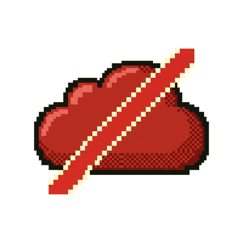

# Pear Pixel Art — Style Guide

How Pear's illustrations, icons, and UI art are built: chunky pixels, dithered shading, and a warm,
friendly hand. Follow this and anything new will feel like it was always part of Pear.

## The reference piece



The "can't connect" cloud (a red, slashed rain cloud) is the canonical example. Every trait below is
visible in it. New art should sit next to this and read as a sibling.

## The DNA

1. **Chunky pixels.** Built on a visible pixel grid. Forms are blocky and low-resolution by design —
   no sub-pixel smoothing in the source art.
2. **Dithered shading, not gradients.** Volume comes from a checkerboard dither, not smooth blends.
   The underside gets a dithered darker tone; the top edge stays lit.
3. **Bold ink outline.** Every shape wears a clean, near-black outline (`#0E140E`). It makes the art
   feel stamped and confident rather than floaty.
4. **One light, top-left.** A single consistent light source across every piece. Highlights land on
   the top/left, the dithered shadow on the bottom/right.
5. **Warm, limited palette.** Per object: a base, a lighter highlight, a darker shadow, plus the ink
   outline. Friendly, rounded silhouettes. Never busy.

## Anatomy

Reading the cloud from outside in:

| Part               | What it is                                                       |
| ------------------ | --------------------------------------------------------------- |
| **Outline**        | Near-black `#0E140E`, 1–2px, wraps the whole silhouette.         |
| **Highlight**      | Lighter tint along the top-left curves.                          |
| **Base fill**      | The object's core mid-tone.                                      |
| **Dithered shadow**| Checkerboard of the darker tone on the underside.               |
| **Cream accent**   | The slash / rim light — a warm off-white edge.                  |

## Palette

Pick a hue, then derive a **lighter highlight** and a **darker, slightly desaturated shadow**. The
outline is always ink. This is the error/red ramp used on the cloud — build other objects the same way.

| Role      | Hex        |
| --------- | ---------- |
| Cream accent | `#FFF3C7` |
| Highlight | `#D94B43`  |
| Base      | `#B3261E`  |
| Shadow    | `#8F1A14`  |
| Outline   | `#0E140E`  |

Warm neutrals the art sits on:

| Role           | Hex        |
| -------------- | ---------- |
| Ground yellow  | `#FFE566`  |
| Surface cream  | `#FCF6E6`  |
| Ink / outline  | `#0E140E`  |

## Make new art — the recipe

Generate with an image model, then clean it up. Fill the `{SLOTS}`:

```
{SUBJECT} icon in the Pear pixel-art style.

Style: 16-bit game sprite. Visible chunky square pixels. Dithered
(checkerboard) shading for volume — lit top/left edge, darker dithered
shadow on the lower-right so it reads rounded, NOT flat. Bold clean
dark outline (#0E140E) around the shape.

Colors: rendered in {HUE} — base {BASE}, lighter highlight {HIGHLIGHT}
on the top-left, darker dithered shadow {SHADOW} underneath, warm cream
accents #FFF3C7.

Background: transparent. One centered icon, tight crop, square 1:1.
Crisp aliased pixels, no anti-aliasing, no blur, no soft drop shadow,
no text. Friendly and warm, cohesive with a cute pixel-art pear mascot.
```

Then clean it up:

- [ ] **Remove the AI watermark** — crop or erase the corner mark; the prompt can't prevent it.
- [ ] **Knock out the background** — make it transparent (models often ignore "transparent").
- [ ] **Crop tight** — trim to the art with minimal padding.
- [ ] **Downsize** — ~128–256px is plenty for a 40–56px slot. Keep it KB, not MB.
- [ ] **Name for meaning, not the drawing** — kebab-case, e.g. `offline-cloud.png`, in `src/assets/images/`.

## Using it in the UI

Import the transparent PNG and render it as a plain `` — no colored container needed, the art
carries its own outline and shading. Size ~40–56px inline; it sits happily on cream surfaces or the
yellow ground.

```tsx
import offlineCloud from "@/assets/images/offline-cloud.png";

;
```

## Do & don't

**Do**

- Shade with dither (checkerboard of the darker tone)
- Keep one light source, top-left
- Wrap every shape in the ink outline
- Hold to ≤4 colors per object + outline
- Favor rounded, friendly silhouettes
- Ship transparent, tightly-cropped PNGs

**Don't**

- Smooth gradients or soft blur
- Drop shadows or glows
- Anti-aliased / feathered edges
- Thin or colored outlines
- Busy, many-color palettes
- Baked backgrounds or AI watermarks
